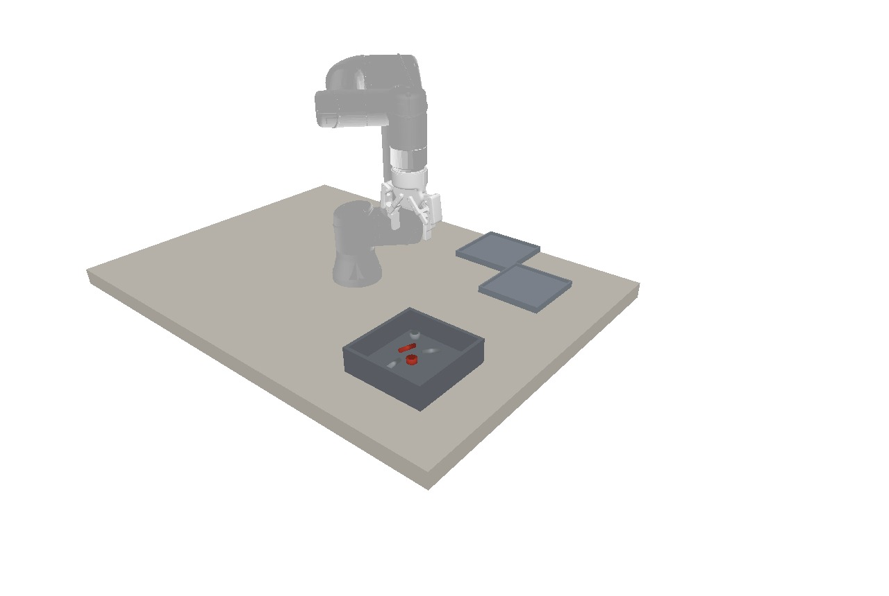
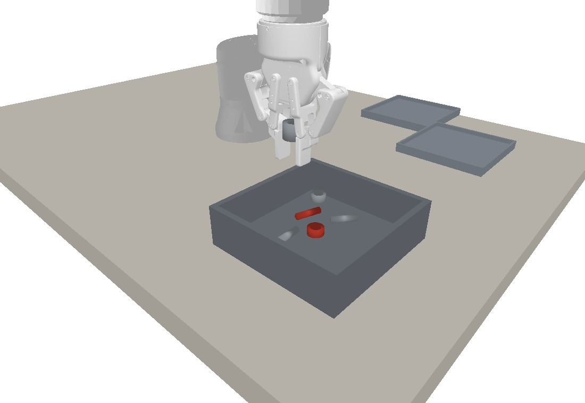

# Puppet to Pilot

A simulated UR5e that I drive with my own arm through a webcam, and a policy that learns to do the job on its own from watching me.

The task is bin sorting. Eight small steel parts (hex bolts, bushings, rings, dowel pins) get dumped in a bin in random positions. Good ones go on one shelf, rejects on the other. I teleoperate the arm to do it, the system records every episode at 30 Hz, and those recordings train a behaviour cloning policy that then runs the task with nobody in front of the camera.

That loop, human demonstrates then data then policy, is how a lot of real robot manipulation actually gets trained. This is a small honest version of it, built from scratch on a laptop with no GPU.





## How it fits together

The webcam stays on Windows and never crosses into WSL. USB passthrough into WSL2 is the single most common way a project like this dies, so I didn't fight it. Perception runs natively on Windows and publishes numbers, not video, over a local socket:

```
WINDOWS                                  WSL2 (Ubuntu 24.04 + ROS 2 Jazzy)

 webcam                                   bridge_node        teleop_node
   │                                     (socket to ROS)    (smooth, retarget,
   ▼                          TCP             │              IK, collision veto)
 MediaPipe pose + hands  ──────────────────►  │  ──────────────────►  │
 ~40 bytes/frame, 30 Hz                                               │
                                                                      ▼
                          data/demos/*.npz  ◄──── PyBullet world + episode recorder
                                  │
                                  ▼
                     dataset → MLP → autonomous policy
```

About 40 bytes cross that boundary per frame: a shoulder relative wrist vector and a calibrated pinch value. Swap the Windows script for a depth camera or a glove and nothing downstream changes.

Everything in `ros2_ws/src/puppet_pilot/` is mine. The kinematics are written from scratch (DH table, forward kinematics, a damped least squares IK solver, quintic trajectories, capsule self collision) with no MoveIt and no KDL. I validated the FK against the URDF by letting PyBullet compute the same poses and comparing over a hundred random configurations.

## Running it

There's a control panel so you don't have to babysit four terminals. Double click `control_panel/OPEN_CONTROL_PANEL.cmd`, which opens a page at `http://localhost:5055`:

- live view of the robot and of the camera, with the tracked arm drawn on it
- start and stop for every component
- flip buttons for each axis, because which direction feels right depends entirely on where your camera sits
- a smoothness slider
- demo count and one click train / evaluate

First run, one time:

```bash
bash scripts/setup.sh          # clones the UR + Robotiq description packages
cd ros2_ws && colcon build
```

and on the Windows side, `windows_side/download_models.py` grabs the two MediaPipe model bundles.

If you'd rather use terminals, or want the native PyBullet window instead of the streamed view:

```bash
python -m puppet_pilot.teleop.bridge_node
python -m puppet_pilot.sim.session --gui --record
python -m puppet_pilot.teleop.teleop_node
```

No webcam handy? `python -m puppet_pilot.tools.synthetic_operator` fakes the operator so you can watch the whole loop run.

## How you actually control it

Move your arm in front of the camera and the gripper follows your wrist. Pinch thumb and index together to close the jaws, spread to open. The tool always points straight down. That's the whole interface.

There's a calibration step at startup, hold your hand open then pinched, because everyone's hands are different sizes and the pinch distance has to be normalised to yours.

## Where it's at

The pipeline works end to end. I've driven the arm live, episodes record and replay cleanly, and the training and evaluation code runs on recorded data. What I don't have yet is the roughly 50 good demonstrations you need before a behaviour cloning policy is worth anything, so the results table below is still empty. I'd rather leave it blank than put a number there I haven't earned.

| | Human-piloted | Autonomous |
|---|---|---|
| Episode success rate | pending | pending |
| Parts sorted (of 8) | pending | pending |
| Mean cycle time | pending | pending |

65 tests pass (`cd ros2_ws/src/puppet_pilot && python -m pytest tests`), covering the kinematics against the URDF, part inertia against an independent mesh integrator, the whole simulation world, and a full record, replay, train, evaluate smoke run.

## Things that broke, and what they taught me

This is the part I'd actually want to talk about.

**The gripper tore the robot apart.** The Robotiq 2F-85's URDF uses `<mimic>` joints, which PyBullet parses and then ignores. The standard fix you'll find in PyBullet examples is gear constraints. The finger links weigh about 40 grams with inertias around 1e-5 kg·m², so the constraint solver's correction torques produced accelerations that propagated up the arm and destroyed the whole robot inside a second. I replaced them with explicit position mirroring that tracks the measured driven angle, which also means that when the jaws stall on a part, the followers stall with them and the pads stay parallel.

**A second simulation silently corrupted the first.** PyBullet's module level API always targets client 0. Connecting a second time doesn't give you an isolated world, it quietly piles the new bodies into the existing one. This showed up as an unexplained physics explosion with no error message anywhere. There's a guard and a test for it now.

**Dowel pins rolled forever.** PyBullet's default rolling friction is zero, so a cylinder that starts rolling never stops. They travelled 46 to 119 mm in three seconds and were still spinning at 36 rad/s, so episodes never settled. The other three part types were rock steady the whole time, which is what made it confusing. Steel on steel rolling resistance went into SPEC.md.

**The gripper's idea of where it grabs is not a point, and it moves.** I'd been treating the finger tip link origin as the jaw reference. The pads actually hang below it and extend 89 to 152 mm under the tool flange, so my grasps were driving them 29 mm through the bin floor. Then it turned out the pads also swing downward another 13 mm during the closing stroke, so staging a grasp at floor level jams them mid close. Both values are measured off the loaded model at startup now, which means swapping in a different gripper needs no code change.

**The bridge could never reach the camera.** The usual recipe for finding the Windows host from WSL2 is to read the nameserver out of `/etc/resolv.conf`. Newer WSL puts a DNS tunnelling address there that isn't the host, so the connection just silently never happened. It uses the default route gateway now.

## What's a fair criticism

- **No force feedback.** Vision teleop is position controlled. I can't feel grip force, so it's set as a fixed ceiling derived from the gripper's drive train (60 N at the pads over the 19.7 mm knuckle lever, about 1.18 N·m) rather than modulated live. Real hardware would want current sensing on the gripper motor or a wrist force torque sensor, and haptics back to the operator.
- **Grasp assist is on.** Because there's no force or tactile feedback and the render runs at about 5 fps, lining a 25 mm part up between the pads by eye is brutal. So while the jaws close, a part within 40 mm of the jaw centre gets pulled toward it and then held. It's in SPEC.md and it applies identically to my demos and to the policy, so the comparison stays fair, but grasp success here is easier than raw physics would be.
- **Inspection is currently a colour cue.** Rejects are red. That's a placeholder for measuring the part against a tolerance band from the camera, which is the upgrade I most want to do next. "v1 sorted by appearance, v2 measured against spec" is a much better story.
- **The policy sees ground truth object poses** from the simulator, not estimated ones. A real deployment needs a perception stack in that slot.
- **Fixed top down tool orientation.** A deliberate retargeting choice, not an oversight (see `docs/phase4-teleop.md`). A human arm has roughly 7 usable degrees of freedom, the UR5e has 6, and I chose to spend the mapping on the channels vision estimates well.
- Rendering is CPU only, so the live view is slow. Physics and recorded data run at full rate regardless.

## Layout

```
SPEC.md               every task parameter. nothing in the code hardcodes these
docs/                 design notes per phase, written before the code
control_panel/        the local web UI
windows_side/         webcam + MediaPipe publisher
robot_model/          my modified xacros, overlaid onto the upstream package
scripts/setup.sh      fetches the upstream description packages
ros2_ws/src/puppet_pilot/
  kinematics/         DH, FK, Jacobian, DLS inverse kinematics, trajectories, collision
  sim/                PyBullet world, procedural parts, gripper model, episode session
  teleop/             retargeting, socket bridge, controller
  recording/          demonstration logging and replay
  learning/           dataset, policy, training, evaluation
```

SPEC.md is the single source of truth for the task. Part dimensions, friction, shelf positions, episode rules, gripper stroke, all of it is parsed at runtime, and the parser refuses to fall back on defaults. Changing a number there changes the behaviour and fails the tests that restate it, which is exactly what I wanted.

## CAD

The arm model here is URDF plus the mesh files from Universal Robots' ROS package, which is display geometry rather than real CAD. If you want proper STEP files for the UR5e, UR publishes them on their own support site: [Universal Robots' download centre](https://www.universal-robots.com/download/) (filter by UR5e, then CAD / STEP). I've linked rather than mirrored them since they're UR's files to distribute.

When I build the custom gripper, designed against the ISO 9409-1-50-4-M6 tool flange, that CAD will live in this repo.

## Credits

UR description is copyright Universal Robots, BSD. Robotiq description comes from PickNik Robotics' `ros2_robotiq_gripper`, BSD. The combined arm and gripper package is based on Addison Sears-Collins' `ur_robotiq`, BSD-3, retargeted from the UR3e to the UR5e. See `robot_model/README.md` for exactly what I changed and why.
