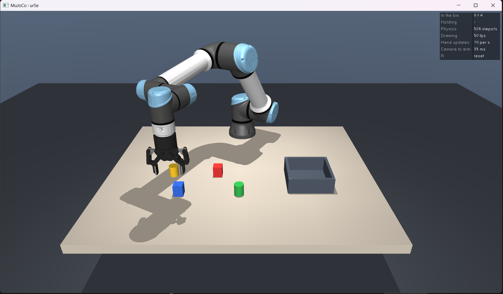
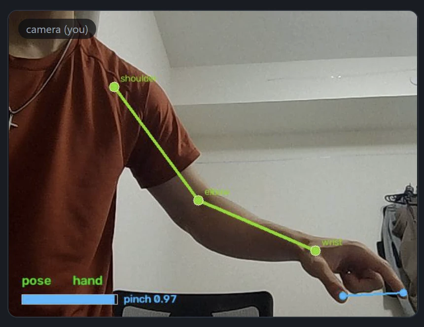

# Robot Arm Simulation

A simulated robot arm that I control with my hand through a webcam.

Move your hand and the arm follows. Pinch to grab an object, carry it over
the bin, and open your hand to drop it in.





## Setup

You need Windows and a webcam.

1. Install [pixi](https://pixi.sh). It downloads everything else for you.
   ```powershell
   winget install prefix-dev.pixi
   ```
2. Download this repository, open a terminal in its folder, and run:
   ```powershell
   pixi install
   ```

## Run

Double-click `start.bat`.

Two windows open: the robot arm, and a small webcam preview. Hold your hand
up in front of the camera to start.

## Controls

| Your hand | The arm |
|---|---|
| Left / right | Left / right |
| Up / down | Up / down |
| Closer to / farther from the camera | Forward / back |
| Pinch thumb and index finger | Grab |
| Open hand | Let go |

An object lights up when it is close enough to grab.

Keys: `C` re-centre your hand, `R` reset the scene, `Q` quit.

## How it works

```
webcam -> [ hand_tracker ] -> target position, open/close -> [ arm_sim ] -> robot arm window
```

Two small programs talk to each other using ROS 2:

- **hand_tracker** finds your hand in the webcam image and works out where
  the gripper should go.
- **arm_sim** moves the simulated arm there and handles grabbing and the bin.

The arm is a UR5e with a Robotiq 2F-85 gripper, simulated in MuJoCo. Hand
tracking uses MediaPipe. More detail is in [SPEC.md](SPEC.md).

## 3D models

The 3D model files for the arm and gripper are in `models/`:

- `models/universal_robots_ur5e/assets/` for the UR5e arm
- `models/robotiq_2f85/assets/` for the Robotiq 2F-85 gripper

They come from [MuJoCo Menagerie](https://github.com/google-deepmind/mujoco_menagerie)
and keep their own licences. My own code is under the MIT licence.
