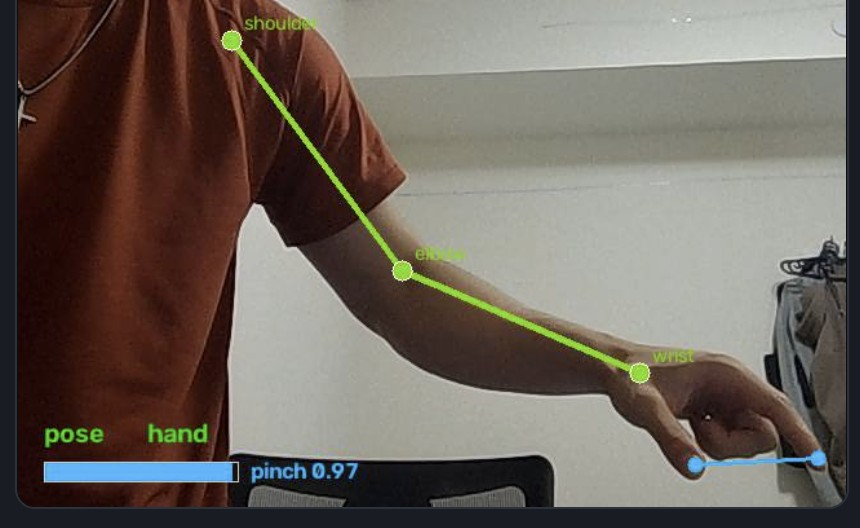

# Robot Arm Simulation

A simulated UR5e that I drive with my own arm through a webcam. Every episode is recorded, and those recordings train a policy to do the task without me.

The task is bin sorting: eight small steel parts spawn in random positions, good ones go on one shelf, rejects on the other.




The overlay draws only what the controller uses: the shoulder, elbow and wrist chain, plus the thumb to index distance that becomes the gripper command.

## How it works

The webcam stays on Windows and never crosses into WSL, because USB passthrough into WSL2 is unreliable. MediaPipe runs natively on Windows and sends about 40 bytes per frame over a local socket: a shoulder relative wrist vector and a calibrated pinch value. A ROS 2 node in WSL picks that up, retargets it to an end effector target, solves IK, and commands the arm in PyBullet.

The kinematics are written from scratch in `ros2_ws/src/puppet_pilot/kinematics/`: DH table, forward kinematics, damped least squares IK, quintic trajectories, capsule self collision. No MoveIt, no KDL. FK is validated against the URDF using PyBullet as an independent check.

## Running it

```bash
bash scripts/setup.sh          # one time: clones the UR + Robotiq packages
cd ros2_ws && colcon build
```

Then double click `control_panel/OPEN_CONTROL_PANEL.cmd` and open `http://localhost:5055`. Click "Start everything", calibrate when prompted (hand open, then pinched), and move your arm. Pinch to close the gripper.

No webcam? `python -m puppet_pilot.tools.synthetic_operator` drives it instead.

## Status

The pipeline runs end to end and 65 tests pass. What's missing is the roughly 50 demonstrations a behaviour cloning policy needs to be worth anything, so the results below are still empty.

| | Human-piloted | Autonomous |
|---|---|---|
| Success rate | pending | pending |
| Parts sorted (of 8) | pending | pending |
| Cycle time | pending | pending |

## Limitations

- **No force feedback.** Vision teleop is position controlled, so grip force is a fixed ceiling (about 1.18 N·m at the knuckle) rather than something modulated live.
- **Grasp assist is on.** Parts within 40 mm of the jaw centre get pulled in as the jaws close. It applies to both my demos and the policy, so the comparison stays fair, but grasping is easier here than raw physics would be.
- **Rejects are red.** A colour cue standing in for real dimensional measurement, which is the next upgrade.
- The policy sees ground truth object poses from the simulator, not estimated ones.
- Tool orientation is fixed top down. A deliberate retargeting choice, since a human arm has 7 usable degrees of freedom and the UR5e has 6.

## Layout

```
SPEC.md               every task parameter, parsed at runtime, nothing hardcoded
docs/                 design notes per phase, including what broke and why
control_panel/        local web UI
windows_side/         webcam and MediaPipe publisher
robot_model/          my modified xacros
ros2_ws/src/puppet_pilot/
  kinematics/  sim/  teleop/  recording/  learning/
```

`puppet_pilot` is the internal package name, from when the project was called Puppet to Pilot.

`docs/` has the design reasoning and the bugs worth reading about: a gripper that tore the robot apart, dowel pins that rolled forever, and a 54 mm error in where the gripper thought it was grabbing.

## CAD

The arm is URDF plus UR's mesh files, which is display geometry rather than CAD. STEP files come from [Universal Robots' download centre](https://www.universal-robots.com/download/).

## Credits

UR description © Universal Robots (BSD). Robotiq description from PickNik Robotics' `ros2_robotiq_gripper` (BSD). Combined arm and gripper package based on Addison Sears-Collins' `ur_robotiq` (BSD-3), retargeted from UR3e to UR5e. See `robot_model/README.md`.
